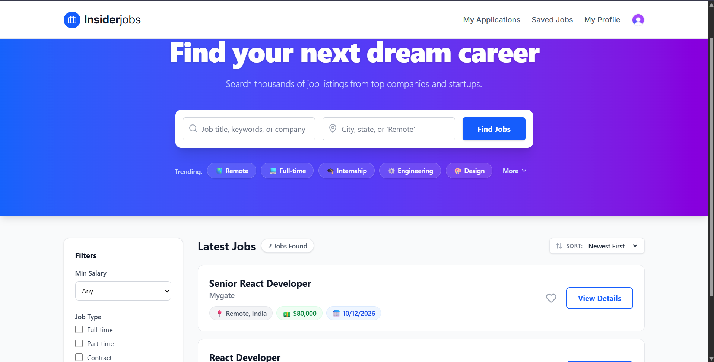
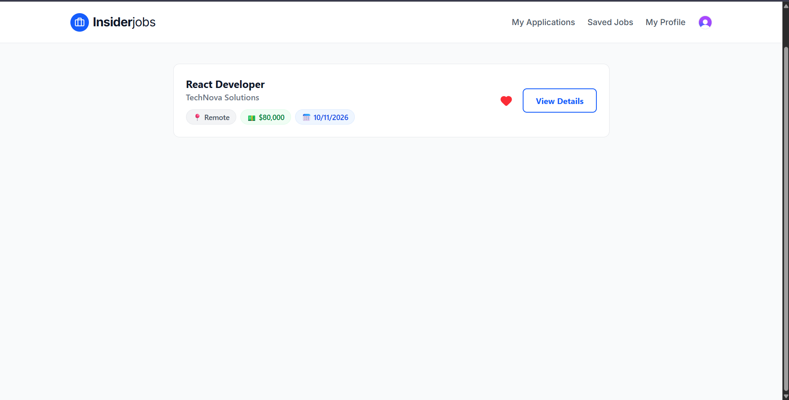
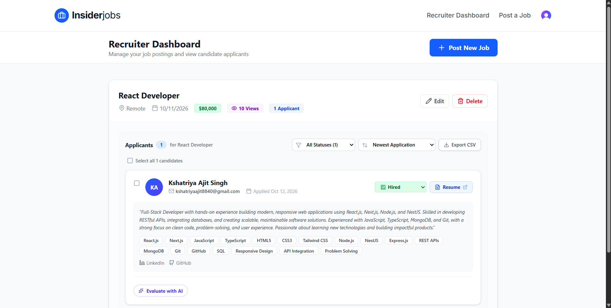
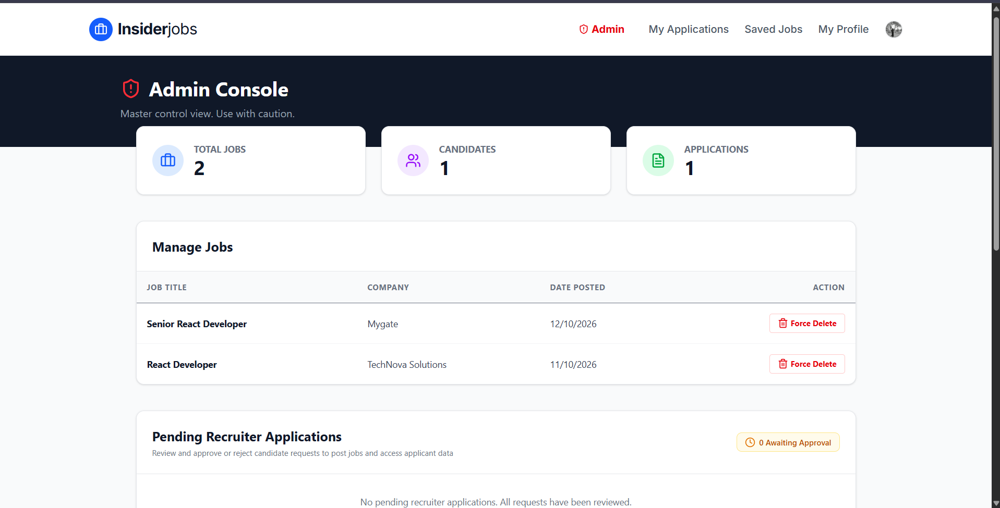
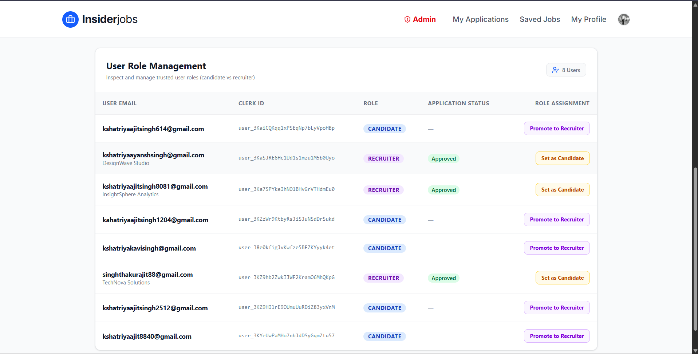

# InsiderJobs

A full-stack job portal built with Next.js, TypeScript, MongoDB, Clerk,
Cloudinary, Gemini AI, and Resend. Candidates can discover jobs and
manage applications, while recruiters can onboard, publish jobs, and
review applicants. Admin tools support recruiter review and platform
management.

**Live website:** https://insiderjobs-hub.vercel.app\
**GitHub repository:** https://github.com/KshatriyaAjit/job-portal

------------------------------------------------------------------------

## Screenshots

### Homepage


### Saved Jobs


### Recruiter Dashboard


### Admin Dashboard


### Admin Dashboard — Details



## Features

### Candidates

-   Sign up and sign in with Clerk authentication.
-   Browse, search, and view job listings.
-   Apply for jobs and track application-related activity.
-   Save jobs for later.
-   Manage a candidate profile and access the candidate dashboard.

### Recruiters

-   Dedicated recruiter sign-up and sign-in flows.
-   Recruiter onboarding and approval workflow.
-   Create and manage job listings.
-   Review applications for recruiter-owned jobs.

### Administration

-   Admin dashboard for platform oversight.
-   Review and approve or reject recruiter access.
-   Manage user roles with server-side authorization checks.

### Platform and integrations

-   MongoDB Atlas with Mongoose for persistence.
-   Clerk for authentication and webhook-based user synchronization.
-   Cloudinary for file/media handling.
-   Google Gemini API for AI-powered functionality.
-   Resend for transactional email.
-   Server-side authorization and ownership checks for protected
    operations.
-   Input validation and HTML sanitization where applicable.
-   Unique application constraints to help prevent duplicate
    applications.
-   Vercel production deployment.

## Technology stack

-   **Framework:** Next.js (App Router)
-   **Language:** TypeScript
-   **UI:** React
-   **Database:** MongoDB Atlas
-   **ODM:** Mongoose
-   **Authentication:** Clerk
-   **File and media storage:** Cloudinary
-   **AI integration:** Google Gemini API
-   **Email:** Resend
-   **Testing:** Jest-based test suite
-   **Deployment:** Vercel

## Getting started

### Prerequisites

-   Node.js compatible with the project's installed Next.js version
-   npm
-   A MongoDB Atlas database or compatible MongoDB instance
-   Clerk application credentials
-   Cloudinary credentials
-   Gemini API key
-   Resend API key

### 1. Clone the repository

``` bash
git clone https://github.com/KshatriyaAjit/job-portal.git
cd job-portal
```

### 2. Install dependencies

``` bash
npm install
```

### 3. Configure environment variables

Create a `.env.local` file in the project root. Add the required values
from your own service dashboards:

``` dotenv
MONGODB_URI=

NEXT_PUBLIC_CLERK_PUBLISHABLE_KEY=
CLERK_SECRET_KEY=
CLERK_WEBHOOK_SECRET=

# Email address authorized as the platform administrator.
ADMIN_EMAIL=

CLOUDINARY_CLOUD_NAME=
CLOUDINARY_API_KEY=
CLOUDINARY_API_SECRET=

GEMINI_API_KEY=
RESEND_API_KEY=

# Used by links/email flows when configured by the application.
APP_URL=https://insiderjobs-hub.vercel.app
```

**Security notes** - Never commit `.env.local` or real API keys,
database credentials, webhook secrets, or other secrets. - Configure
production environment variables in Vercel separately from local
development. - Keep `ADMIN_EMAIL` server-side; admin privileges must not
be granted based on client-controlled profile metadata. - Configure
Clerk's production URLs and webhook endpoint in the Clerk dashboard. -
Configure a verified sender domain in Resend before sending email to
arbitrary recipients. - Use the correct Cloudinary, MongoDB, and Gemini
credentials for each environment.

Some service configuration may require additional variables depending on
the features enabled in your deployment. Check the project's
environment-variable usage before deploying a fresh instance.

### 4. Run locally

``` bash
npm run dev
```

Open <http://localhost:3000>.

### 5. Run checks

``` bash
npm test
npx tsc --noEmit
npm run lint
npm run build
```

Run the checks supported by your current checkout. If a script is not
defined in `package.json`, use the project's configured equivalent.

## Important routes

  Area                   Path
  ---------------------- -------------------------
  Admin dashboard        `/admin`
  Candidate dashboard    `/dashboard`
  Recruiter login        `/recruiter-login`
  Recruiter sign-up      `/recruiter-sign-up`
  Recruiter onboarding   `/recruiter-onboarding`
  Post a job             `/post-job`
  Health check API       `/api/health`
  Clerk webhook          `/api/webhooks/clerk`

Other job, application, profile, and saved-job routes are part of the
application. Their exact paths may vary with the current implementation.

## Production deployment

The project is deployed on Vercel.

1.  Import the GitHub repository into Vercel.
2.  Add production environment variables in **Project Settings →
    Environment Variables**.
3.  Configure Clerk's production domain, allowed redirect URLs, and
    webhook URL.
4.  Configure a verified sender domain in Resend if transactional emails
    must reach arbitrary recipients.
5.  Deploy the `main` branch and verify authentication, database access,
    job posting, applications, uploads, and email flows.

**Live URL:** https://insiderjobs-hub.vercel.app

## Security considerations

-   Protected operations should be authorized on the server, not only
    hidden in the UI.
-   Recruiter permissions should come from trusted server-controlled
    state or an admin approval process.
-   Validate ownership before changing jobs or applications.
-   Validate uploaded file types and URLs, and sanitize user-generated
    HTML before rendering it.
-   Keep credentials in environment variables and rotate any secret that
    has been exposed.
-   Review dependency security alerts regularly; avoid applying forceful
    dependency upgrades without checking compatibility.

## Contributing

1.  Fork the repository or create a feature branch.
2.  Make a focused change.
3.  Run the test suite, type check, lint, and production build.
4.  Open a pull request describing the change and its verification.

## License

No license is specified here. Add a `LICENSE` file and update this
section if you intend to publish the project under a particular
open-source license.
